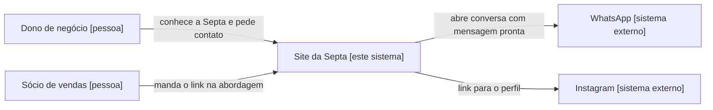
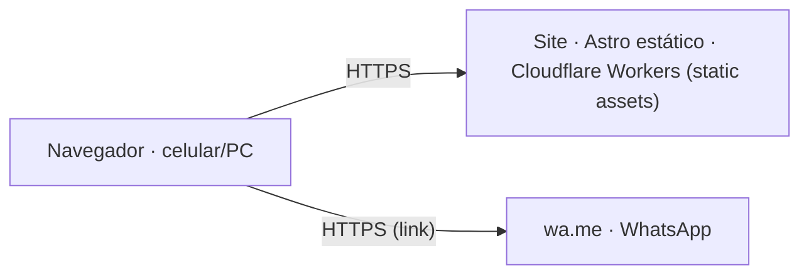
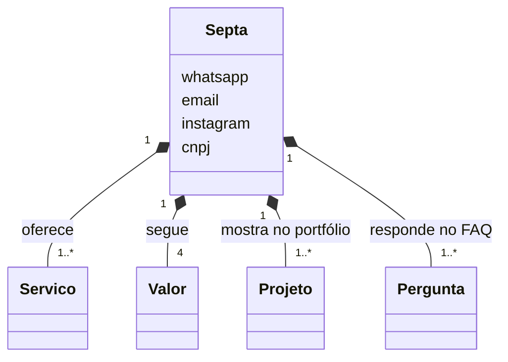

# Arquitetura: Site da Septa Systems

Status: rascunho · Base: `docs/projeto/prd.md` · Data: 24/11/2026

## 1. Contexto (C4 nível 1)

## 2. Containers (C4 nível 2)

Sem servidor, sem banco e sem worker: o site é HTML pronto. O Three.js vai junto no build (não vem de CDN de terceiros).

## 3. Restrições

- **Técnicas:** `modelo-site` (Astro 7 + Cloudflare). Até comprar o domínio, endereço `*.workers.dev`.
- **Do time:** um dev monta em poucos dias, a partir do rascunho aprovado.
- **Do projeto:** custo zero além do domínio (~R$ 40/ano). Repo público: nada de senha, número pessoal ou dado de cliente no código.

## 4. Partes do site

| Arquivo                              | Responsável por                                                  |
| ------------------------------------ | ---------------------------------------------------------------- |
| `src/config/site.ts`                 | contatos, `MENU`, `SERVICOS`, `PASSOS`, `VALORES`, `FAQ`         |
| `src/styles/marca.css`               | cores, fontes e tamanhos (os tokens do rascunho)                 |
| `src/components/FundoTech.astro`     | fundo fixo: brilhos, malha de pontos e rede de conexões          |
| `src/components/Topo.astro`          | logo e menu                                                      |
| `src/components/Abertura.astro`      | título, botões e o `Logo3D`                                      |
| `src/components/Logo3D.astro`        | canvas 3D (Three.js) com o logo plano de reserva                 |
| `src/components/Servicos.astro`      | 6 cartões que inclinam com o mouse                               |
| `src/components/PainelExemplo.astro` | painel do sistema em perspectiva (dados fictícios)               |
| `src/components/ComoFunciona.astro`  | 4 passos                                                         |
| `src/components/Portfolio.astro`     | projetos                                                         |
| `src/components/Sobre.astro`         | missão, valores e o logo com anéis                               |
| `src/components/Faq.astro`           | perguntas frequentes (`
`, sem JS)                       |
| `src/components/Contato.astro`       | canais e o `FormContato`                                         |
| `src/components/Rodape.astro`        | rodapé                                                           |
| `src/scripts/`                       | `logo3d.ts`, `rede.ts`, `inclinar.ts`, `painel.ts`, `contato.ts` |
| `src/pages/index.astro`              | junta as seções                                                  |
| `src/pages/privacidade.astro`        | política de privacidade curta (o site não coleta dados)          |

Textos e dados ficam no `site.ts` ou na própria seção, nunca repetidos em dois lugares.

## 5. Modelo de domínio

Site institucional, sem regra de negócio. Os dados são listas fixas no `site.ts`:

`whatsapp` e os preços do FAQ começam como `PENDENTE`; `cnpj` vazio não aparece no rodapé. O build de produção falha enquanto existir algum (CT06).

## 6. Fluxos principais

1. **Conhecer e chamar:** o dono abre o link, lê a abertura e toca em "Fale com a gente", que leva ao Contato.
2. **Mandar mensagem:** preenche nome, o que precisa e um texto; o `contato.ts` monta "Olá! Vim pelo site. Sou {nome}, preciso de {serviço}. {texto}" e abre o `wa.me`.
3. **Ver um sistema:** rola até Sistemas; o painel se endireita e os números contam do zero.

## 7. Segurança e LGPD

- Sem login, sem banco e sem cookies: o site **não guarda dado pessoal**. O formulário só monta um link; quem envia é a própria pessoa, no WhatsApp dela.
- A página `/privacidade` diz isso em linguagem simples.
- Medição: contar as conversas com "Vim pelo site". Se entrar analytics, Cloudflare Web Analytics (sem cookie).
- Cabeçalhos de segurança e HTTPS: os do `modelo-site`. Three.js vai pelo `npm`, sem script de CDN de fora.

## 8. Requisitos de qualidade

| Estímulo                                | Resposta                  | Medida                                                                            |
| --------------------------------------- | ------------------------- | --------------------------------------------------------------------------------- |
| Dono abre o site no 4G                  | a página aparece rápido   | Lighthouse celular: Desempenho ≥ 90; LCP ≤ 2,5 s                                  |
| O 3D carrega                            | não trava a rolagem       | Three.js só baixa depois que a página carregou; anima a ≤ 60 fps                  |
| Aba em segundo plano ou 3D fora da tela | para de gastar bateria    | animações pausam (IntersectionObserver e `visibilitychange`)                      |
| Pessoa com leitor de tela               | entende e navega          | Lighthouse Acessibilidade ≥ 95; 3D e painel com `aria-hidden` e texto alternativo |
| Busca "criar site para pequeno negócio" | o Google entende a página | Lighthouse SEO = 100; `Organization` no JSON-LD                                   |

## 9. Decisões (ADRs)

- [ADR 0001: 3D e animações com JavaScript no site da Septa](adr/0001-3d-e-animacoes.md)
- [ADR 0002: Marca nova no site (Lexend e fundo #01080A)](adr/0002-marca-do-site.md)

## 10. Riscos

| Risco                                  | Chance | Impacto | O que fazer                                                      |
| -------------------------------------- | ------ | ------- | ---------------------------------------------------------------- |
| 3D pesado derruba o Desempenho         | média  | alto    | ADR 0001: carregar depois, limitar pixels, medir CT09 em todo PR |
| Celular fraco esquenta ou trava        | média  | médio   | menos partículas e pixels no celular; pausa fora da tela         |
| Dado pendente ir ao ar inventado       | média  | alto    | CT06: build falha com `PENDENTE`                                 |
| Painel de exemplo parecer cliente real | baixa  | médio   | aviso "dados fictícios" embaixo do painel                        |
